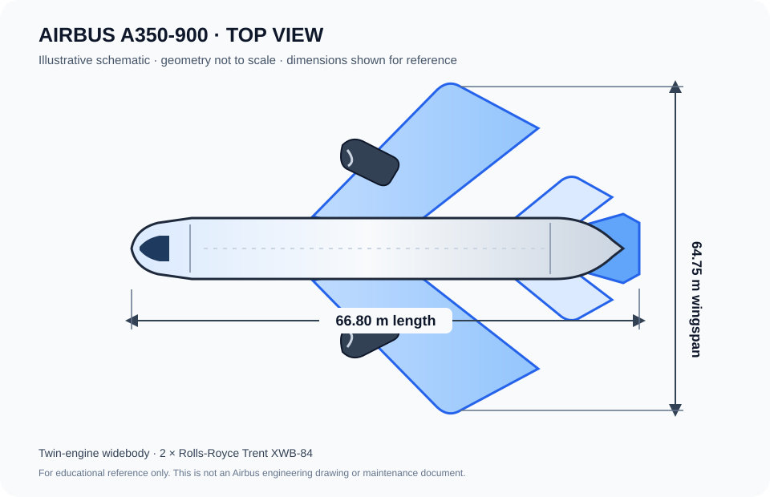

# A350 Fleet Airworthiness Intelligence

A small Python and SQLite demonstration of continuing-airworthiness audit concepts for a fictional A350-900 fleet. It shows relational fleet records, engine EGT margin estimates, life-limited-part threshold checks, directive evidence tracking, composite repair inspection dates, and a terminal report.

## A350-900 schematic



The diagram is an original educational schematic. It is not to scale and is not an Airbus engineering drawing.

## Aircraft specifications

Representative public specifications for the A350-900 are summarized below. Performance and weight figures vary by aircraft variant and configuration.

| Specification | A350-900 |
|---|---:|
| Overall length | 66.80 m (219 ft 2 in) |
| Wingspan | 64.75 m (212 ft 5 in) |
| Overall height | 17.05 m (55 ft 11 in) |
| Fuselage width | 5.96 m (19 ft 7 in) |
| Typical seating | 332–352 passengers in a three-class layout |
| Maximum certified seating | 440 |
| Engines | 2 × Rolls-Royce Trent XWB-84 |
| Take-off thrust | 84,000 lbf per engine |
| Cruise speed | Mach 0.85 |
| Maximum take-off weight | 250 t (Basic); higher-weight configurations are available |
| Range | Configuration-dependent; Airbus lists 7,500 nm for the Basic configuration and up to 9,700 nm for the A350-900ULR |
| Materials mix | Airbus reports over 70% advanced materials, including 53% composites |

Sources: [Airbus A350-900 specifications](https://www.aircraft.airbus.com/en/aircraft/a350/a350-900) and [Airbus A350 Family Facts and Figures (March 2026 PDF)](https://mediaassets.airbus.com/pm_38_875_875661-0tw0rakiue.pdf?fileName=airbus-a350-family-facts-and-figures-march-2026.pdf). The range and weight values depend on variant and configuration; the ULR range is specific to that version.

## Important scope

All aircraft, engine, repair, directive, and engineering-order records in this project are synthetic examples. They do not describe Finnair or any real operator. Thresholds and maintenance intervals are illustrative placeholders, not certified limits or approved instructions. The project is for software-learning purposes only; it must not be used for maintenance planning, dispatch, release to service, or airworthiness decisions. Always use current approved technical data and the operator's authorized procedures.

## Engineering analysis companion

The repository also includes a separate [landing-gear torque-link fatigue screening study](engineering/torque-link-fatigue/README.md). It demonstrates net-section stress, Goodman-corrected Basquin life, Miner damage accumulation, a simplified mass estimate, and generated CSV/JSON/SVG outputs from synthetic inputs. It is an analytical illustration rather than FEA or a safe-life substantiation; the companion README lists its assumptions and limitations.

## Run

Requires Python 3.10 or later. The demo uses only the Python standard library.

```bash
python a350_camo_auditor.py
```

Choose an audit date:

```bash
python a350_camo_auditor.py --as-of 2026-11-07
```

The script creates an in-memory SQLite database, loads synthetic sample records, checks them against clearly labeled demonstration thresholds, estimates example EGT threshold dates with a simple linear model, and prints a report. No persistent database or external service is required.

## Project structure

- `a350_camo_auditor.py` — runnable demonstration and SQLite schema
- `a350-900-schematic.svg` — illustrative top-view aircraft schematic
- `engineering/torque-link-fatigue/` — standalone analytical fatigue-screening companion
- `README.md` — project overview, specifications, and usage

## Possible extensions

- Replace the in-memory demo data with a validated import pipeline.
- Add unit-aware data validation, audit history, and signed source references.
- Build an optional dashboard after defining an approved data model.
- Add automated checks once the project requirements and verified reference data are settled.

## License

This project is provided under the MIT License. See `LICENSE`.
